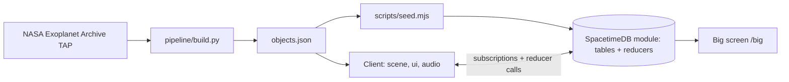

# PlaceX

**Zillow for the universe, and everyone at Cal Hacks is bidding.**

PlaceX is a live multiplayer real estate market for the real universe. Fly through thousands of real exoplanets from the NASA Exoplanet Archive at their true positions, see each one's physics-based price, hear what its atmosphere would sound like, and claim it before another hacker does. Every claim lands on every screen at once through SpacetimeDB.

Built at Cal Hacks 13.0 in Cursor with Claude Code subagents. In-game credits only. Prices and sounds are physics-inspired estimates and the UI says so.

- Live: _(URL added at launch)_
- Big screen mode: _(URL)/big_
- Database: SpacetimeDB Maincloud, database `placex`

## Run locally

```bash
# 1. local SpacetimeDB
spacetime start

# 2. server module
cd server && npm install && npm run publish:local && npm run generate && cd ..

# 3. seed the universe
npm install && npm run seed:local

# 4. client
cd client && npm install && npm run dev
# open http://localhost:5173 (uses ws://127.0.0.1:3000 and placex-local by default)
# or VITE_MOCK=1 npm run dev to run against fake data with no server
```

Point the client at the cloud with `VITE_STDB_URI=wss://maincloud.spacetimedb.com VITE_STDB_DB=placex`.

## Smoke test

```bash
npm run smoke:local    # two clients, one claim, race check, auction-only check
```

## Layout

```
server/          SpacetimeDB module (TypeScript)
client/          Vite + React + react-three-fiber
  src/bindings/  generated by `spacetime generate`, never hand-edited
  src/state/     connection, hooks, mock provider (the contract every UI piece uses)
  src/scene/     3D universe
  src/ui/        landing, HUD, listing card, leaderboard, ticker
  src/audio/     Web Audio atmosphere engine
  public/data/   objects.json from the pipeline
pipeline/        Python: NASA archive to objects.json
scripts/         seed, smoke test, load test
docs/            PRD, build log, Cursor tasks, QA, Devpost
```

## Architecture



Data: [NASA Exoplanet Archive](https://exoplanetarchive.ipac.caltech.edu/), `pscomppars` table.
